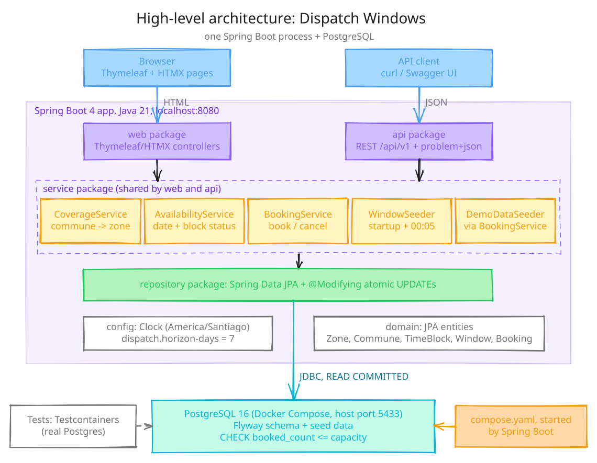
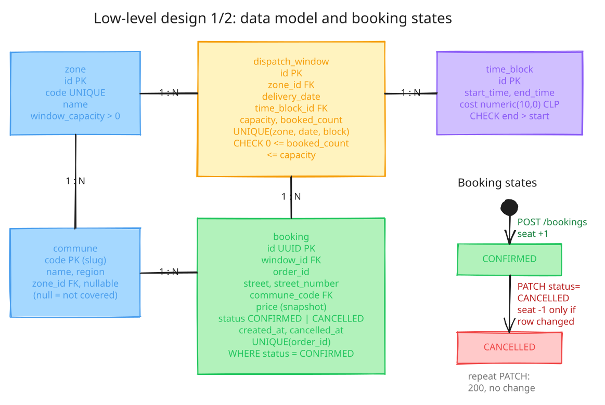
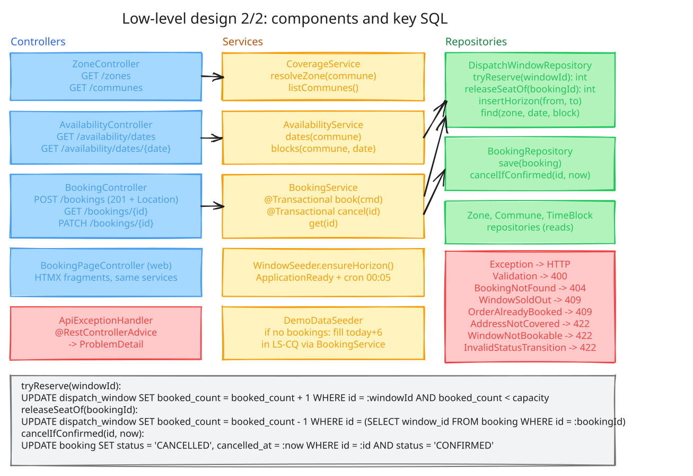
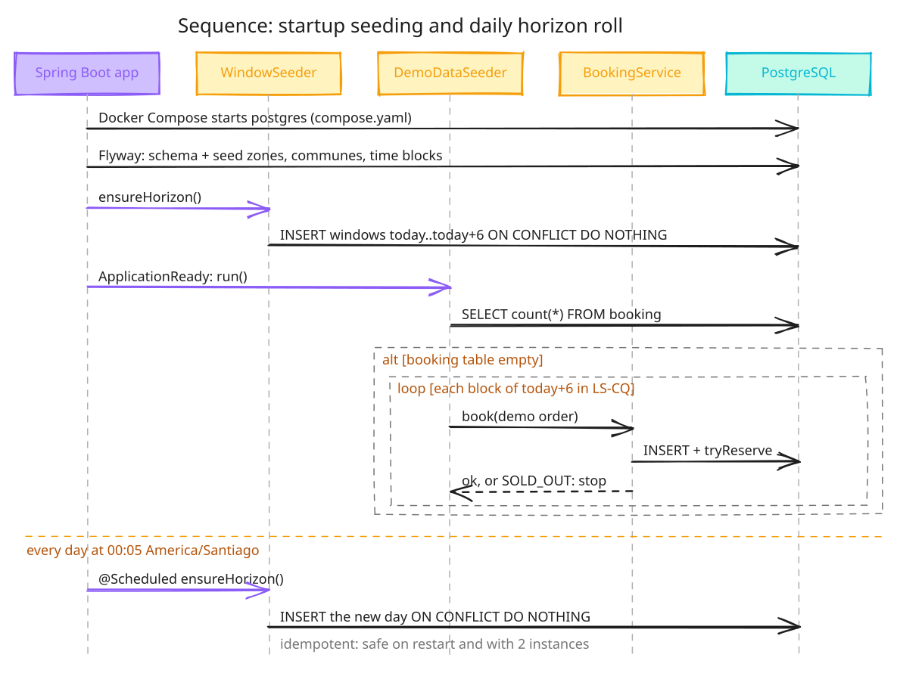
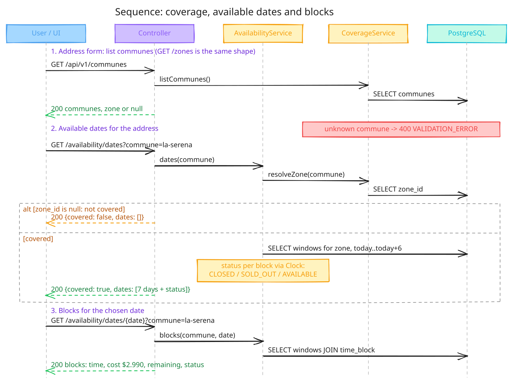
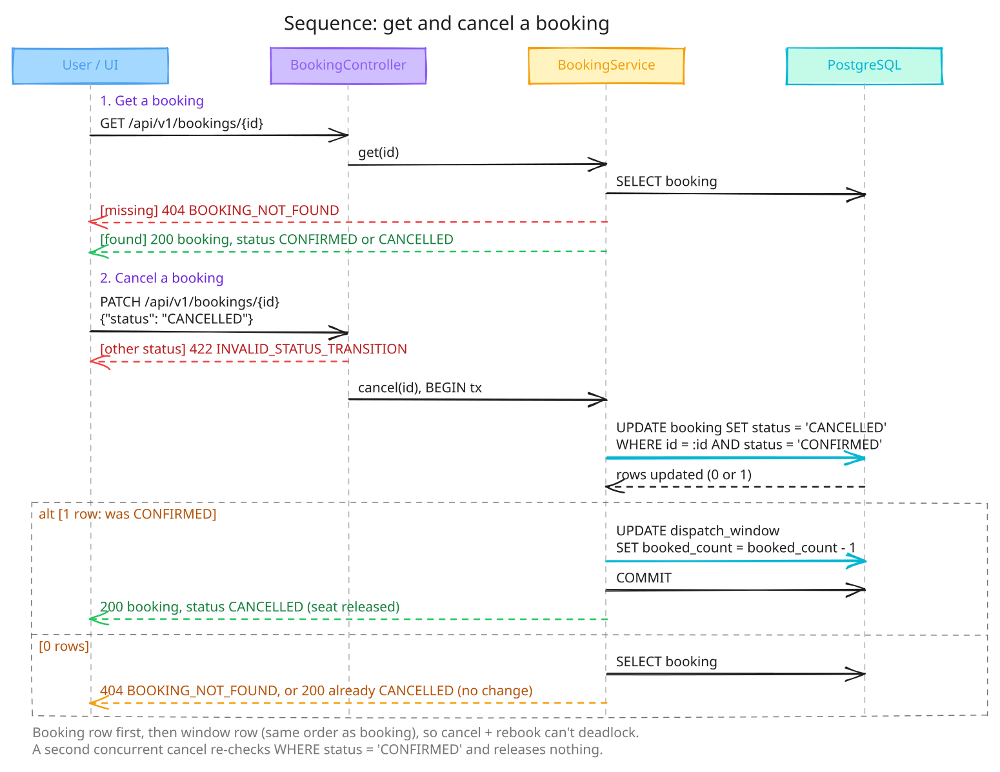
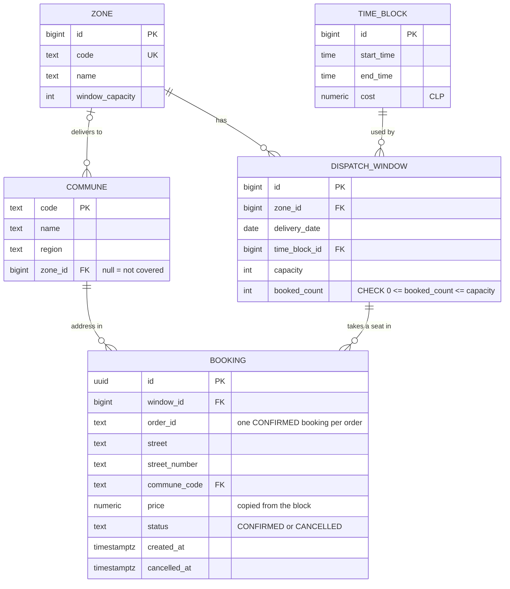
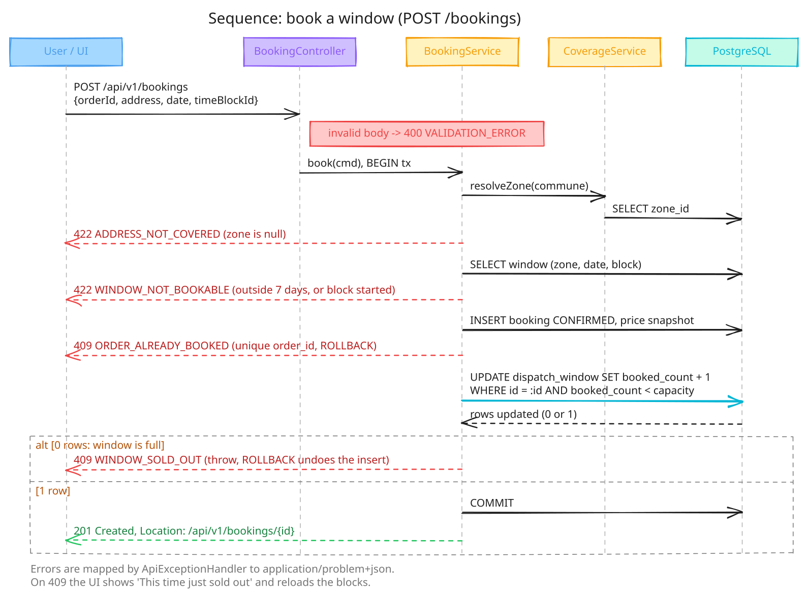
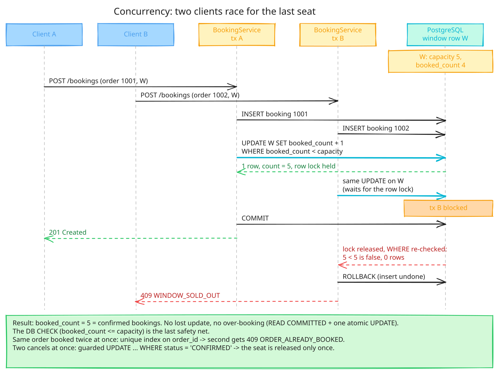

# Dispatch windows with geographic coverage

This is my take on the dispatch window challenge. A customer gives a delivery address, the system works out which zone covers it, shows the next 7 days with their time blocks and prices, and lets them book one block for their order. Each block has limited capacity, and the main thing I wanted to get right is that it can never be over-booked, no matter how many requests arrive at once.

There's a REST API (documented with Swagger) and a small web page modelled on the booking screen shown in the challenge.

## Running it

You need **JDK 21** and **Docker** running (Docker Desktop or any engine with `docker compose`). Nothing else: no local Postgres, no Node, no config files to edit.

```bash
./mvnw spring-boot:run
```

On Windows use `mvnw.cmd spring-boot:run`.

The first run takes a minute or two, depending on your connection, because the Maven wrapper downloads Maven and the dependencies (about 120 MB) and Docker pulls `postgres:16-alpine`. After that it starts in about 5 seconds. What happens on startup:

1. Spring Boot reads `compose.yaml` and starts Postgres 16 in Docker. It's mapped to host port **5433**, not 5432, so it won't clash with a Postgres you may already have installed.
2. Flyway creates the tables and loads the zones, communes and time blocks.
3. The app creates the delivery windows for today and the next 6 days, and books out one day as demo data (more on that below).

Then open:

| What | URL |
|---|---|
| Booking page | http://localhost:8080 |
| Swagger UI | http://localhost:8080/swagger-ui.html |
| OpenAPI spec | http://localhost:8080/v3/api-docs |

`Ctrl+C` stops the app, and Spring Boot stops the Postgres container with it. The data stays in the container, so bookings survive a restart. To start again from an empty database, run `docker compose down -v` first.

If port 8080 is taken, run `SERVER_PORT=8081 ./mvnw spring-boot:run`. If 5433 is taken, change it in `compose.yaml`; that's the only place it appears.

All dates and times use Chile's time zone (`America/Santiago`), whatever your machine is set to. "Today" means today in Santiago.

## What to try

The seed data starts from the reference screen in the challenge (an address in La Serena, two-hour blocks at 2,990 Chilean pesos) and adds more coverage around it.

| | |
|---|---|
| Zones | `LS-CQ` La Serena - Coquimbo (5 orders per window), `SCL-CO` Santiago Centro-Oriente (8), `VAL-VDM` Valparaíso - Viña del Mar (5) |
| Covered communes | `la-serena`, `coquimbo` (LS-CQ); `santiago`, `providencia`, `las-condes`, `nunoa`, `vitacura`, `la-reina`, `lo-barnechea`, `recoleta`, `independencia` (SCL-CO); `valparaiso`, `vina-del-mar`, `concon`, `quilpue`, `villa-alemana` (VAL-VDM) |
| Not covered | `vicuna`, `ovalle`, `maipu`, `puente-alto`, `quillota` |
| Time blocks | Seven back-to-back two-hour blocks from 08:00 to 22:00 (08:00-10:00, 10:00-12:00 ... 20:00-22:00), CLP 2,990 each |
| Sold out | On a fresh database, every block of the **last day** (today + 6) is fully booked in LS-CQ |

The mappings are made up for the demo. They aren't real coverage data.

On the booking page:

1. Enter any order number, `Monjitas`, `2334`, and pick **La Serena**. Click "See dates and times".
2. The strip shows 7 days. The last one is greyed out and says **Sold out**. If it's late in the day, today says **Closed** because all its blocks have started.
3. Pick a day and a block, then **Book**. You get a confirmation with a "Cancel booking" button.
4. Click **Change** and switch the commune to **Vicuña** to see "We don't deliver to this address".

To see what happens when someone else takes the last seat, open the same day in two tabs. In one tab, book the same block with different order numbers until it's full (5 bookings). Then press Book for that block in the other tab. You'll get "This time just sold out" and the blocks refresh.

## The API with curl

All endpoints are under `/api/v1`. Swagger has the full contract; this is the short tour.

Dates for an address. Only the commune decides coverage, so that's the only thing this needs:

```bash
curl -s "localhost:8080/api/v1/availability/dates?commune=la-serena"
```

```json
{"commune":"la-serena","covered":true,"dates":[{"date":"2026-11-10","status":"CLOSED"},{"date":"2026-11-11","status":"AVAILABLE"}, ... ,{"date":"2026-11-16","status":"SOLD_OUT"}]}
```

Each date is `AVAILABLE`, `SOLD_OUT` (every block still open is full) or `CLOSED` (every block has already started). For `vicuna` you get `"covered":false` and no dates.

Blocks for one of those dates. Use a date from your own output:

```bash
DATE=2026-11-12
curl -s "localhost:8080/api/v1/availability/dates/$DATE?commune=la-serena"
```

```json
{"commune":"la-serena","date":"2026-11-12","covered":true,"blocks":[{"timeBlockId":1,"start":"08:00:00","end":"10:00:00","cost":2990,"currency":"CLP","remaining":5,"status":"AVAILABLE"},{"timeBlockId":2,"start":"10:00:00","end":"12:00:00", ...}, ...]}
```

Book a block. On a fresh database `timeBlockId` 2 is 10:00-12:00:

```bash
curl -si -X POST localhost:8080/api/v1/bookings -H 'Content-Type: application/json' \
  -d '{"orderId":"ORD-1001","address":{"street":"Monjitas","number":"2334","commune":"la-serena"},"date":"'$DATE'","timeBlockId":2}'
```

```
HTTP/1.1 201
Location: http://localhost:8080/api/v1/bookings/0b1c6c4e-...
{"id":"0b1c6c4e-...","orderId":"ORD-1001","address":{...},"date":"2026-11-12","start":"10:00:00","end":"12:00:00","price":2990,"currency":"CLP","status":"CONFIRMED", ...}
```

Try the sold-out last day (the last date from the first call) and you get a `409`:

```bash
LAST=2026-11-16
curl -s -X POST localhost:8080/api/v1/bookings -H 'Content-Type: application/json' \
  -d '{"orderId":"ORD-1002","address":{"street":"Monjitas","number":"2334","commune":"la-serena"},"date":"'$LAST'","timeBlockId":2}'
```

```json
{"detail":"The 10:00 block on 2026-11-16 is sold out","instance":"/api/v1/bookings","status":409,"title":"Window sold out","code":"WINDOW_SOLD_OUT"}
```

Cancel with the id from the `Location` header. The seat goes back to the window:

```bash
curl -s -X PATCH localhost:8080/api/v1/bookings/<id> -H 'Content-Type: application/json' -d '{"status":"CANCELLED"}'
```

Every error is `application/problem+json` with a `code` you can switch on:

| Status | Code | When |
|---|---|---|
| 400 | `VALIDATION_ERROR` | Missing or invalid fields (listed in `errors`), bad JSON, bad date or id, unknown commune |
| 404 | `BOOKING_NOT_FOUND` | No booking with that id |
| 409 | `WINDOW_SOLD_OUT` | The block is full |
| 409 | `ORDER_ALREADY_BOOKED` | The order already has a confirmed booking |
| 422 | `ADDRESS_NOT_COVERED` | No zone delivers to that commune |
| 422 | `WINDOW_NOT_BOOKABLE` | Date outside the 7 days, block already started, or unknown block |
| 422 | `INVALID_STATUS_TRANSITION` | `PATCH` with any status other than `CANCELLED` |

The rest of the API: `GET /zones`, `GET /communes` and `GET /bookings/{id}`.

## How it's built

Java 21, Spring Boot 4.1, Spring Data JPA, PostgreSQL 16, Flyway, springdoc for Swagger, Thymeleaf and HTMX for the page, Testcontainers for tests.

```
src/main/java/com/retail/dispatch
  domain      entities and the availability rules
  repository  Spring Data repositories, including the atomic UPDATE queries
  service     coverage, availability, booking, window and demo seeders
  api         REST controllers, request/response records, error handling
  web         the booking page (Thymeleaf + HTMX)
  config      clock, properties, OpenAPI
src/main/resources/db/migration   Flyway schema and seed data
```

The REST controllers and the page call the same services. Entities never leave the service layer; the API only returns records.



The diagrams in this README are SVG exports of the `.excalidraw` files in `docs/`. To edit one, drag the `.excalidraw` file onto [excalidraw.com](https://excalidraw.com), then export it again as SVG into `docs/svg/`. The rest are here:

<details>
<summary>Data model and booking states</summary>


</details>

<details>
<summary>Components and key SQL</summary>


</details>

<details>
<summary>Sequence: startup seeding and the daily horizon roll</summary>


</details>

<details>
<summary>Sequence: coverage, available dates and blocks</summary>


</details>

<details>
<summary>Sequence: get and cancel a booking</summary>


</details>

### Entity model



- A **zone** is a group of communes. Each commune points to at most one zone, so two zones can't overlap. A commune with no zone is one we know about but don't deliver to. Each zone sets how many orders a window can take (`window_capacity`: 5 for La Serena - Coquimbo and Valparaíso - Viña del Mar, 8 for Santiago Centro-Oriente, set in `V2__reference_data.sql`).
- A **time block** is a delivery slot like 16:00-18:00 with a price. All zones share the same blocks.
- A **dispatch window** is one zone, one date and one block. It holds the capacity and how many seats are taken. The capacity is copied from the zone when the window is created, so changing a zone's capacity only affects windows created after that. The app creates 7 days of them ahead and adds a new day every night at 00:05.
- A **booking** takes one seat in a window for one order. It keeps a copy of the price, so changing a block's price later doesn't change what an existing booking says it cost.

### How over-booking is prevented

The rule is simple: for every window, `booked_count` equals the number of confirmed bookings, and never goes above `capacity`. All of this is enforced in the database, so it holds with any number of app instances.

Booking runs in one transaction:

1. Insert the booking row. A partial unique index on `order_id` (only for confirmed bookings) rejects a second booking for the same order.
2. Take a seat with one statement: `UPDATE dispatch_window SET booked_count = booked_count + 1 WHERE id = ? AND booked_count < capacity`.
3. If that updated 0 rows, the window is full. Throwing rolls back the transaction, which also removes the booking row from step 1.



The check and the increment happen in the same statement. Postgres locks the row while it updates it, so concurrent bookings for the same window wait in line, and each one checks `booked_count < capacity` against the latest committed value. There's no gap between reading the count and writing it, which is where over-booking usually comes from. On top of that, a `CHECK (booked_count <= capacity)` constraint means even a bug in my code couldn't over-book.



Cancelling is `UPDATE booking SET status = 'CANCELLED' WHERE id = ? AND status = 'CONFIRMED'`, and the seat is only given back if that changed a row. Two cancels of the same booking at the same moment can't both give a seat back.

Both booking and cancelling touch the booking row before the window row. If one did it the other way round, cancelling an order and re-booking it at the same moment could deadlock.

I used Postgres's default READ COMMITTED isolation. The single conditional UPDATE is enough, so SERIALIZABLE and its retry loop would only add cost. I also didn't use optimistic locking (`@Version`) on the window. Under load, all those requests would fail and retry against the same hot row, while the conditional UPDATE just makes them wait their turn.

The tests prove this rather than assume it (see below).

### Why Thymeleaf and HTMX for the page

The challenge said to pick what's best for the UI, so I went for what keeps the project simple to run. The page is rendered by the same Spring Boot app, and HTMX swaps in server-rendered HTML for each step. That means one process, one command, no Node toolchain, and the page calls the same services as the API, so the rules can't drift apart. HTMX is bundled in the project, so it works offline. The trade-off is less client-side polish than a React app would give, which I think is fine for a screen this size.

## Tests

```bash
./mvnw test
```

Tests run against a real Postgres 16 in Docker through Testcontainers, so Docker needs to be running. There's no H2 anywhere, because the guarantees above rely on how Postgres actually locks rows. The whole suite takes about 30 seconds once the dependencies are downloaded. To run one test class:

```bash
./mvnw test -Dtest=BookingConcurrencyTests
```

The tests pin the clock to Monday 2030-03-04 16:30 in Santiago, so the "block has already started" rule gives the same answer whenever they run.

The concurrency tests in `BookingConcurrencyTests` start real threads at the same moment:

- 50 bookings for a window with 5 seats give exactly 5 bookings and 45 `WINDOW_SOLD_OUT`.
- 10 bookings of the same order give exactly 1 booking.
- 20 cancels of the same booking give back exactly 1 seat.
- Bookings and cancels mixed on one window never over-book.
- 200 cancel and re-book races on the same orders never deadlock.

After each test, every window's `booked_count` is checked against its confirmed bookings.

To make sure these tests can actually fail, I broke the code on purpose three ways: removed the capacity check, released seats on every cancel, and swapped the lock order. The tests caught each one. The first version of the deadlock test missed the swapped lock order, because one race per round rarely lines up. That's why it now runs 10 pairs per round.

## Assumptions

The challenge leaves some things open. This is what I decided and why.

- **Address means commune.** In Chile delivery coverage is normally decided by commune, and the reference screen shows a street address, not a postal code. The booking stores street and number, but only the commune decides coverage.
- **Same time blocks and price everywhere.** The reference shows the same $2.990 for every block. Price per zone would be a column on the window.
- **Delivery runs 08:00 to 22:00 in back-to-back two-hour blocks.** The reference only shows evening blocks that overlap. Blocks that don't overlap are easier to choose from, and each one has its own capacity.
- **One confirmed booking per order.** An order is delivered once. After cancelling, the order can be booked again.
- **7 days ahead**, like the date strip on the reference screen.
- **Same-day booking is allowed** until the block starts. I didn't add a cut-off before that.
- **Capacity is counted in orders**, not weight or volume.
- **Booking is one step.** The reference has a single "Reservar" button, so there's no hold-then-confirm. Cancelling wasn't asked for, but a booking system without it felt incomplete.
- **Home delivery only.** The reference also has a "Retiro Pickup" tab, which I left out.

## Running this in production

The design already holds with several app instances, because the database decides every booking. A few things I'd still do:

- **Short transactions and a sized connection pool.** A booking is a few statements, but waiting for a busy window's row lock holds a connection. The pool should be sized for peak traffic on the busiest windows, with a lock timeout so requests fail fast instead of piling up.
- **Spread out hot windows.** If one window gets far more traffic than others (say, the evening block before Christmas), I'd split its counter into a few rows and take a seat from any of them, so requests don't all queue on one lock.
- **Cheap reads.** The availability endpoints could read from a replica or a short cache. That's safe because the booking itself always re-checks capacity on the primary, so stale availability only means someone occasionally gets a 409.
- **Hold a seat during checkout.** In a real checkout I'd hold the seat for 10 minutes or so, then confirm it on payment. Expired holds would be released by a job that uses `FOR UPDATE SKIP LOCKED`, so several instances can share the work.
- **Idempotency keys** on `POST /bookings`, so a client that retries after a timeout doesn't hit `ORDER_ALREADY_BOOKED` for its own booking.
- **Watch it.** I'd track sold-out and conflict rates per zone and lock wait times, to see when a zone needs more capacity.
- **One window job at a time.** The nightly job that creates windows is already safe to run on several instances at once (`INSERT ... ON CONFLICT DO NOTHING`). I'd still run it from one instance with a scheduler lock to keep the logs clean.

## What I left out

Authentication, the pickup option, holds and idempotency keys (see above), customer data, and admin endpoints for zones and blocks. Those change through Flyway migrations for now. With more time I'd add the checkout hold first, since that's what a real store would need next.
